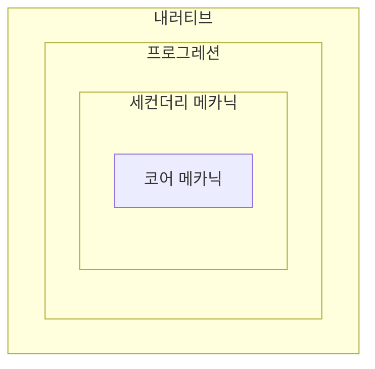

## 1. 이론과 개념

### 1. 코어 메커닉스 다이어그램

#### 구조
- 어떤 대상, 현상에 대한 연구를 시작할 때 가장 먼저 할 작업은 분류다.
- 게임의 분류는 플랫폼, 상호작용 대상, 장르, 게임의 목적, 행위 등을 기준으로 분류할 수 있다. 이 중 게임의 목적과 행위는 메커닉스에 영향을 받는 요소다.
- `게임 메커닉스`란 사전적 의미로, **게임에 필요한 기능을 실현하기 위해 관련 요소를 어떤 법칙에 따라 조합한 집합체**를 가리킨다. 게임 메커닉스의 목적은 게임의 목표를 이루기 위해 필요한 기능과 기술을 제공하고 이를 사용하는 데 있어서 체계화하는 것이다.
- 모든 디자이너는 자신만의 디자인 방법론을 갖고 있을 가능성이 높으나, 일반론이 되긴 어렵다. 게임의 많은 요소를 디자인에 연결하는 게 쉽지 않고, 어떤 요소가 게임에 적합하지 분명하지 않기에 게임 디자이너 김샤미는 `코어 메카닉스 다이어그램`을 도입했다.

- **핵심 메커니즘이 가장 중심에, 다른 메커니즘이 주위에 형성된다.**

1. **코어 메카닉(Core Mechanic)**
	- 게임에서 가장 자주 발생하는 의도적인 상호작용. 행동이다. 
	- 코어 메카닉이 없으면 게임을 전혀 플레이할 수 없다.
	- ex) <슈퍼마리오>의 점프, <배틀그라운드>의 사격, <카트라이더>의 운전
2. **세컨더리 메카닉(Secondary Mechanic)**
	- 코어 메카닉보다는 덜 자주 발생하는 상호작용. 이 안에서 가장 많이 발생하는 행동부터 가장 적게 발생하는 행동까지 계층화할 수 있다.
3. **프로그레션(Progression)**
	- 진행 메커니즘. 게임의 규칙을 형성하며 전체적인 수준에서 게임 시스템 내 변화의 원천이 된다.
4. **내러티브(Narrative)**
	- 모든 레이어를 맥락에 포함시키는 가장 바깥쪽에 위치한다. 
	- 게임 스토리, 세계관 등.

#### 특징
- 레이어와 관계를 이해하는 것을 넘어, 그것들이 게임의 재미에 어떻게 영향을 주는지 염두에 두고 레이어 간의 관계가 이뤄지도록 디자인해야 한다. 

1. **좋은 게임은 이해하기 쉽고, 확장할 여지가 있는 매우 강력한 핵심 메커니즘이 있다.** 메커니즘이 자체로 강력한 의미를 갖는다면 플레이가 된다. 또한, **좋은 게임은 각 레이어가 서로를 보완한다.**

2. 정말 신선한 경험은 종종 게임 핵심의 혁신에서 비롯된다.

3. 때때로 혁신은 레이어의 특이한 조합에서 비롯된다. 

4. 매우 일반적인 핵심 메커니즘은 다른 레이어를 강하게 만들어내기도 한다. 

- 예를 들어, 어떤 디자이너는 보조 메커니즘이나 진행 없이, 핵심 활동에 집중해 <단일 점프>의 물리학에 많은 관심을 기울일 수도 있다. 하지만 다른 장르, 예를 들면 전략 게임의 경우 핵심 매커니즘은 <유닛 배치>인 경우가 많은데, 이 자체는 즐거운 일이 아니나 이를 두뇌 활동으로 보면 핵심 메커니즘이 얼마나 깊고 의미가 있을 수 있는지, 전략 게임이 재미 있는 이유를 알 수 있다.

- 또한, 전략 게임의 핵심 메커니즘은 훨씬 더 복잡하고 그 안에 다양한 피드백 루프가 포함되어 있다. 많은 성공적인 게임은 한 핵심 다이어그램에서 다른 핵심 다이어그램으로 이동하는 모달 전환을 수행한다. 

- 모든 게임이 코어 메커닉스 다이어그램 틀에 맞는 건 아니나, 게임 디자인 프로세스에서 아주 유용하다. 

### 2. 목표 설정
- **목표는 플레이어가 게임을 플레이해 나갈 수 있도록 방향을 잡아주고, 도전을 제공하고, 분위기를 결정한다.** 그러므로 목표는 명확하게 명시해야 한다. 둘 이상이라면 각 목표와 함께 이들이 어떻게 관계되는지를 명시해야 한다. 
- 목표를 어떤 형식으로 두든, 목표는 게임의 형식 체계뿐만 아니라 극적인 측면에도 영향을 주므로 신중하게 디자인해야 한다.

#### 특성
>[!note]
>**좋은 게임 목표의 특성**
>1. 명확하고 구체적이어야 한다.
>2. 달성 가능해야 한다.
>3. 가치가 있어야 한다.
>4. 보상이 있어야 한다.
>5. 배분 가능해야 한다.
>6. 스스로 정할 기회가 있어야 한다.

- 가치
	- 목표를 달성했을 때 성취감이나 보람이 있어야 한다. 목표 달성에 가치가 있다면 달성해가는 과정에도 가치가 생긴다.
- 보상
	- 목표를 달성했을 때 보상이 있어야 한다. 물질적인 것만큼, 플레이어가 목표를 달성했을 때 느끼는 만족감 또한 중요하다. 
	- 단 적절한 가치를 맞출 것.
- 배분
	- 목표를 단기적, 장기적으로 잘 배분한다면 당장 무엇을 해야 하고 최종적으로 어떤 것을 이룰 수 있을 지 알 수 있다.
- 스스로 정할 기회
	- 게임 디자이너가 최초에 게임 목표를 의도적으로 설계하나, 플레이어는 게임에서 자신만의 또다른 목표를 만들 수 있기도 하다.

#### 자주 나타나는 목표
- 세계 구하기
	- 처음부터 큰 목적
	- 작은 목표로 시작하다가 결과적으로 세계 구하기
- 종족의 이권과 생존을 놓고 벌어지는 전쟁
- 다른 나라 정복하기
- 마왕 퇴치
- 도시 건설
- 공주 구하기
- 도시, 농장, 자식 육성
- 생존
- 연애

- 보드게임
	- 획득
	- 추격 
	- 영역 차지/점령/정복
	- 건설/개척
	- 연결
	- 탈출/생존
	- 범인 잡기
	- 만들기
	- 도착

### 3. 객체, 속성, 상태, 행동, 관계

#### 객체
- 분리할 수 없는 독립된 하나의 조각. 
- 데이터 및 데이터의 조작 방법에 대한 정보를 포함하며, 게임 진행과 결과의 행위에 영향을 미친다.
- 게임을 이루는 모든 것으로, 시스템의 성격에 따라 물리적이거나 추상적일 수 있다.
- 예시
	- 축구 : 공, 골대, 선수, 운동장. 각각은 게임 플레이에 필요한 물리적 요소.
	- 체스 : 보드판과 32개의 체스말. 
	- 포커 : 카드

>[!note]
>**객체 요소와 요인**
>1. **객체** : 독립된 하나의 조각, 구성물
>2. **속성** : 객체가 가지고 있는 고유 성질이나 특성
>3. **상태** : 객체의 현재 상황
>4. **행동** : 객체를 작동하는 원리
>5. **관계** : 객체 간의 행동으로 인한 상호작용
- 일반적으로 **객체에는 하나 이상의 속성이 있으며, 속성은 현재의 상태를 갖는다. 상태는 객체의 행동에 의해 변하고, 행동으로 인한 상호작용에 의해 객체들은 어떤 관계를 가진다.**

#### 속성
- **객체가 가지고 있는 고유의 성질이나 특성 등, 정보를 나타내는 범주.** 
- **현재의 상태**를 갖는다. 그 자체로는 의미가 없지만, 게임 시스템에서 여러 속성이 모여 하나의 객체를 구성하면 중요한 의미를 표현할 수 있다.
- 속성 간에는 상성이 존재한다. 
- 객체가 상호작용을 결정하는 데 유용한 정보를 제공하고 필요한 데이터를 생성한다.
- 예시
	- <체스>의 킹, 퀸, 비숍 등 말의 속성은 색깔과 위치다.
	- <모노폴리>에서 처음 구매한 나라에 건물을 짓고, 호텔을 건설하면 더 많은 돈을 벌어들일 수 있다. 
- 디지털 게임의 경우 캐릭터 속성은 체형, 의상, 표정, 체력, 기술, 힘, 경험, 레벨 위치 등 보드게임보다 훨씬 복잡하며, 속성에 대한 변화도 복잡해지므로 상호작용과 결과 예측도 어려워진다.

#### 상태
- 속성으로 인해 변화된 객체의 현황.
- 상태변화를 꼭 알려줄 필요는 없다. 장르에 따라 다르다. 

#### 행동
- 게임 내 객체가 주어진 상태에서 취할 수 있는 행동.
- 행동이 다양할수록 객체 변화 예측이 어려워진다.
- 예시
	- <체스> 
		- 킹은 직선과 대각선 방향으로 1칸 이동해 상대의 말을 잡을 수 있다.
		- 비숍은 대각선 방향으로 이동할 수 있지만, 경로에 다른 말이 있으면 건너뛰지 못한다.
	- <슈퍼마리오> : 걷기, 뛰기, 말하기, 싸우기, 동전 획득하기 등.

#### 관계
- 게임 시스템에서 가장 중요한 것은 객체의 행동으로 인한 상호작용으로 만들어진 객체 간의 관계다. 
- <체스>에서 각 말의 이동 방향을 설정하니, 어떤 말을 움직이면 다른 말의 움직임이나 이동 방향에 영향을 줄 수 있는 의미 있는 관계가 만들어진다.
- 관계는 객체들의 위치, 공간 이동, 계층 구조 등 다양하게 표현할 수 있다. 또하, 디자이너가 아무리 다양하게 표현하더라도 플레이하는 전개 방식에 따라 위치가 바뀔 수 있다. 

#### 정보의 공개와 비공개
- 객체의 속성과 상태를 결정할 때, 게임에서 누가 어떤 것을 알게 되는가가 중요하다. 
- 이건 게임마다 다르다. 내 것은 숨기고 상대의 것을 알아내야 한다든가, 모든 정보를 숨긴다든가, 일부는 드러내고 일부는 숨긴다든가 등등.
- [[2. 소재, 테마]]에서 보드게임의 정의 : '숨겨진 정보를 극적으로 공개하기 위해 의미 있는 선택을 하는 것.'
	- 플레이를 위해 너무 많은 정보가 필요하다면 진입장벽이 생기고, 너무 없다면 어려움을 느껴 포기하게 된다. **드러나는 정보와 숨겨지는 정보 간의 비율이 중요하다.**

#### 시스템 상호작용 특성
- `시스템 역학`은 우리 주변의 현상, 사물을 파악하는 것으로, 핵심 개념은 시스템 구성 요소들이 어떻게 작용하는가를 이해하는 것이다. 
1. **연결 시스템** : <틱택토>와 <코드톡>
	- 둘다 3x3 판을 쓰는 게임. <코드톡>은 대신 9개의 숫자를 쓸 수 있다. 사용할 수 있는 객체의 수가 2개 vs 9개라서 코드톡 쪽이 결과를 예측하는 게 훨씬 어려워진다.
2. **교환 시스템** : <핏>과 <컬렉션>
	- 두 게임 모두 교환이 핵심 시스템이지만, <핏>은 자신의 패를 숨기고 진행하는 반면 <컬렉션>은 패는 숨기되 수집 상황의 정보는 공개되므로 예측이 더 가능한 구조다.
3. **경제 시스템** : <매직 더 개더링>
	- 플레이어는 원만한 플레이를 위해 서로 카드를 거래해서 덱을 만든다. 매우 희소한 카드가 있다.

### 4. 규칙
- 규칙은 게임의 모든 것을 규정해 메커닉스를 단단하게 한다. 액션을 규정하고, 공간, 객체, 속성, 상태까지 모든 메커니즘에 관여해 게임이 게임다워질 수 있게 한다. 
- 규칙은 플레이어에게 적당한 수준과 방법으로 제공되는 것이 좋다. 플레이어와의 관계를 고려하여 디자인해야 한다. 
- 규칙을 디자인할 때 고려해야 할 특징
	1. **규칙은 명확해야 한다**. 
	2. **규칙은 직관적이어야 한다.** 게임은 복잡한 시스템과 컨텐츠가 얽혀 있어서 복잡한데, 이를 단순화해서 이해하기 쉽게 디자인해야 한다.
	3. **규칙은 즉각적인 피드백이 이뤄져야 한다.** 플레이어의 행동 후, 어떤 변화가 일어났는지 플레이어가 알아챌 수 있어야 한다. 그래야 실시간으로 액션을 결정하고 상황에 집중하게 된다.
	4. **규칙은 공정해야 한다.**

#### 1. 객체와 개념을 정의하는 규칙
- 게임의 객체는 고유의 상태와 그에 따른 의미가 있다. 객체가 게임 내에서 어떤 성격을 지니는가는 규칙으로 정의해야 한다. 
- 객체는 명시적으로 규칙의 일부로 정의하며, 플레이어는 규칙을 숙지하고 게임 상황과 결과를 스스로 판단할 수 있어야 한다. 그래서 보드게임은 대부분 단순한 객체를 사용한다. 
	- 각 객체는 1~2가지 변수나 상태만 가능하며, 보통 카드, 보드, 다른 인터페이스 요소의 물리적인 면을 이용해 상태를 표시한다.
- 게임 객체와 개념을 정의할 때, 플레이어가 객체의 특징을 어떻게 알게 되는지를 염두에 둬야 한다. 

#### 2. 행동을 제한하는 규칙
- <체스>의 '체크를 당할 곳으로 킹을 움직이지 못한다.', <바둑>의 '바둑한 상태를 이전과 똑같이 만드는 수를 둘 수 없다.'는 규칙은 게임 시스템의 잠재적 허점을 보완해주는 규칙이다.
- 행동 제한은 기초적인 **한계 설정**의 형태를 띤다. 이외에도 **특정 플레이어가 너무 유리해지는 상황을 막기도 한다.**

#### 3. 결과를 결정하는 규칙
- 규칙은 어떤 상황을 바탕으로 결과를 불러온다. 몇 가지 유용한 점이 있다.
1. 게임 플레이가 다양해진다. 특정 상황에서만 발생하므로 게임 플레이가 흥미진진해진다.
2. 게임 플레이를 옳은 방향으로 이끌 때 사용할 수 있다. 
	- 예시 : '마나를 모두 소진하면 치명적이지는 않지만, 그에 대한 대가를 치르게 된다'는 규칙을 명시하면 플레이어가 마나를 모두 잃지 않도록 노력하게 만든다.

- 디지털 게임의 경우, 게임이 공정하다고 생각하도록 직관적으로 규칙을 파악할 수 있어야 한다. 보통 규칙이 복잡할수록 이해시키기 위해 플레이어에게 요구하는 게 많아지는데, 이해도가 낮아지면 의미 있는 선택을 할 확률도 낮아지고 게임 플레이를 통제한다는 느낌도 덜해질 것이다.

## 2. 메커니즘 분석

### 덱 만들기
- `덱 만들기Deck Building`은 2008년에 등장한 새로운 매커니즘으로, 카드들을 이용해 덱을 만드는 것이다. TCG에서 파생된 것으로, 덱이 가변적이며 승리를 위해서 원하는 덱을 만들어야 한다는 재미가 있다.
- 덱을 만드는 규칙은 크게 2가지가 있다.
	1. `덱 구축Deck Constructed` : 이미 보유한 카드를 이용해 덱을 만드는 것.
	2. `리미티드 덱Limited Deck` : 부스터 카드를 이용해 덱을 만드는 데 제한을 두는 것.
- 2007년, `로널드 X. 비카리노` 작가가 덱을 만드는 과정 자체를 게임으로 만들겠다는 발상을 떠올렸다. MTG 부스터 팩을 까서 7~8명이 둘러앉아 드래프팅을 했는데, 이를 활용해 나중에 <도미니언>을 만들게 된다.
- 예시 게임 : <도미니언>, <스타워즈>

## 3. 실습하기
- 목표 : 게임 규칙 만들기

1. 코어 메커닉스 다이어그램을 활용해 게임에 적용할 메커니즘을 정한다.

2. 게임의 목표를 정한다.

3. 게임에 필요한 규칙을 정한다.

